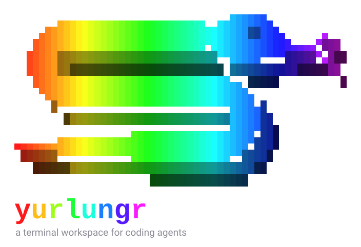

<p align="center">
  
</p>

<p align="center">
  <b>A terminal workspace for coding agents.</b><br>
  Persistent panes, workspaces, and a live view of every agent you have running.
</p>

---

## Install

One command, then type `yurlungr` in any terminal.

**Linux and macOS**

```sh
curl -fsSL https://raw.githubusercontent.com/mirimomekiku/yurlungr/main/install.sh | sh
```

**Windows (PowerShell)**

```powershell
irm https://raw.githubusercontent.com/mirimomekiku/yurlungr/main/install.ps1 | iex
```

**Windows (Command Prompt)**

```bat
powershell -NoProfile -ExecutionPolicy Bypass -Command "irm https://raw.githubusercontent.com/mirimomekiku/yurlungr/main/install.ps1 | iex"
```

The installer downloads a prebuilt binary for your system, checks its SHA-256
checksum, puts it in a folder of your own (no `sudo`, no administrator), and adds
that folder to your `PATH`. Open a new terminal window and type:

```sh
yurlungr
```

The installers (and `yurlungr setup`) greet you with the snake: a 2.5D rainbow snake whose colours
flow once around it on a colour terminal. Set `YURLUNGR_NO_ANIM=1` to skip the animation; it is
also skipped automatically when output is piped or has no colour.

<details>
<summary><b>What exactly does the installer do?</b></summary>

| | Linux / macOS | Windows |
|---|---|---|
| Installs to | `~/.local/bin` | `%LOCALAPPDATA%\Programs\yurlungr` |
| Adds to `PATH` by | a marked block in `~/.bashrc`, `~/.zshrc` or fish `conf.d`, plus your login file | your *user* `PATH` in the registry (the current PowerShell window is updated too) |
| Verifies | SHA-256 of the download, or it installs nothing | SHA-256 of the download, or it installs nothing |
| Needs | `curl` or `wget`, `tar` | PowerShell 5.1 or newer |
| Upgrades | run it again | run it again (a running session's `.exe` is renamed aside, since Windows locks it) |

If a release has no prebuilt binary for your system, the installer builds yurlungr
from source instead. That needs [Rust](https://rustup.rs) 1.85 or newer and a C compiler;
on Linux/macOS it offers to install Rust for you first.

**Options**

```sh
# Linux / macOS: pass options after `sh -s --`
curl -fsSL https://raw.githubusercontent.com/mirimomekiku/yurlungr/main/install.sh | sh -s -- --version v0.1.0
#   --version <tag>   --dir <path>   --from-source   --no-modify-path   --yes   --uninstall
```

```powershell
# Windows: options are environment variables
$env:YURLUNGR_VERSION = 'v0.1.0'; irm https://raw.githubusercontent.com/mirimomekiku/yurlungr/main/install.ps1 | iex
#   YURLUNGR_VERSION  YURLUNGR_INSTALL_DIR  YURLUNGR_FROM_SOURCE  YURLUNGR_NO_MODIFY_PATH  YURLUNGR_UNINSTALL
```

**Uninstall** removes the program, the agent hooks it added, and the `PATH` entry. It keeps your settings.

```sh
curl -fsSL https://raw.githubusercontent.com/mirimomekiku/yurlungr/main/install.sh | sh -s -- --uninstall
```

```powershell
$env:YURLUNGR_UNINSTALL = 1; irm https://raw.githubusercontent.com/mirimomekiku/yurlungr/main/install.ps1 | iex
```

</details>

<details>
<summary><b>Build from source</b></summary>

```sh
git clone https://github.com/mirimomekiku/yurlungr
cd yurlungr
cargo install --path .        # installs to ~/.cargo/bin
```

Requires Rust 1.85+ and a C compiler. Development: `cargo test`, `cargo fmt`,
`cargo clippy`. Architecture notes are in [`CLAUDE.md`](CLAUDE.md).

The snake is generated: edit the flat snake in `assets/snake-face.txt`, then run
`python scripts/make-snake.py` (builds the shaded 2.5D `assets/snake.txt`) and
`python scripts/make-logo.py` (builds the animated `assets/logo.svg`). Tests fail if the
installers' embedded copies drift from `assets/snake.txt`.

</details>

## What it looks like

```text
┌ spaces ────────────────┐┌ ○ idle terminal ──────────────────────────────┐┌ git graph ────────────────────────────────────┐
│ · yurlungr             ││$ █                                            ││● 72af82c (main, origin/HEAD, origin/main) Docu│
│ ● api                  ││                                               ││● 7774ede Add close confirmations, tabbed setti│
│ ● docs                 ││                                               ││● 78b1331 Bind Alt+1..9 to panes and Ctrl+1..9 │
│                        ││                                               ││● 09dbf53 Add local-only account and usage coll│
│                        ││                                               ││● 13ff612 Document workspaces, the agents sideb│
│                        ││                                               ││● c48a27a Wire up workspaces, agents sidebar, g│
│                        ││                                               ││● 2fa4064 Bind Alt+arrows and Alt+PageUp/PageDo│
│                        ││                                               ││● c2b63f8 Probe each terminal's foreground proc│
│                        ││                                               ││● b56eb50 Add workspace model and agent state r│
│                        ││                                               ││● fed9257 Add agent detection from a pane's for│
│                        ││                                               ││● 5373ed5 Add commit details to the git graph b│
│                        ││                                               ││● da8382d Update CLAUDE.md for Alt+N and Ctrl+T│
│                        ││                                               ││● b4c1ada Request kitty keyboard disambiguation│
└────────────────────────┘│                                               ││● 7db3014 Bind Alt+1..9 to jump to a pane and r│
┌ agents 2 ──────────────┐│                                               ││● 2559eef Document keymap, config, themes, dial│
│ api                    ││                                               ││ commit ───────────────────────────────────────│
│ ● claude       working ││                                               ││ commit    72af82c704d1ed60f6141251ef02237983b8│
│ docs                   ││                                               ││ author    dlord213 <lollingworld41@gmail.com> │
│ ● codex        blocked ││                                               ││ committer dlord213 <lollingworld41@gmail.com> │
│                        ││                                               ││ parents   7774ede                             │
│                        ││                                               ││                                               │
│                        ││                                               ││  Document confirmations, tabbed settings and t│
│                        ││                                               ││                                               │
│                        ││                                               ││ 1 file changed, +5 -4                         │
│                        ││                                               ││ M CLAUDE.md                             +5 -4 │
│                        ││                                               ││                                               │
│                        ││                                               ││                                               │
│                        ││                                               ││                                               │
└────────────────────────┘│                                               ││                                               │
  + space   ≡ menu        └───────────────────────────────────────────────┘└───────────────────────────────────────────────┘
 ctrl+b prefix · split ctrl+left ctrl+right ctrl+down · pane alt+N · space ctrl+N · menu: prefix m
```

On the left, **spaces** are workspaces (each rolls up the most urgent state of its agents) and
**agents** lists every coding agent running anywhere, with what it is doing. On the right,
panes: a shell, and a git graph that shows who authored and committed the selected commit and
which files it changed.

## Features

- **Persistent sessions.** A background server owns your shells. Close the terminal, lose the
  SSH connection, `Ctrl+B d` to detach: everything keeps running. Run `yurlungr` again to
  reattach. Named sessions with `yurlungr -s work`.
- **Workspaces.** Each workspace has its own panes, layout and project folder. Create, rename,
  close and switch from the sidebar, the menu, or the keyboard.
- **An agents list.** Agents are found by looking at what is running in each pane (`claude`,
  `codex`, `opencode`, `gemini`, `qwen`, `kimi`, `droid`, `aider` and more), so they show up with
  no setup (on Windows an agent appears once its hooks report in, since a pty's foreground process can't be inspected there). States are **working**, **blocked** (waiting for you), **done** (finished while you were
  looking elsewhere) and **idle**. Install hooks for exact state (below).
- **Works in any terminal.** The theme's colours are lowered to what your terminal can show
  (truecolor, 256 or 16 colours; override with `YURLUNGR_COLORS=truecolor|256|16`), and yurlungr
  says so clearly if it has no terminal to draw on. Keys a terminal keeps for itself have prefix
  fallbacks (see the terminal note below).
- **One window per session.** Starting `yurlungr` on a session that is already open in another
  terminal is refused, so two windows never fight over it. Detach there (`Ctrl+B d`), or pass
  `--force` (`-f`) to take the session over; the other window is detached.
- **Splits.** `Ctrl+Left`, `Ctrl+Right` and `Ctrl+Down` split the focused pane. Drag the dividers
  to resize; right-click for a menu, which also has **Open in Explorer** (Finder, or your file
  manager) for the pane's folder.
- **Git graph pane.** Commit lanes, plus a detail panel with the full id, author and committer
  (with timestamps), parents, message, and changed files with `+`/`-` counts.
- **File browser and editor.** Create, rename, move, copy, cut, paste and delete (only `y`
  confirms; deleting is permanent), and a small modal text editor. One file viewer per workspace.
  The viewer follows its file on disk, so a file an agent just changed is not shown stale, and
  saving over a file that changed since you opened it is refused once (save again to overwrite).
- **Asks before it destroys anything.** Closing a workspace, a terminal pane, or an editor with
  unsaved changes opens a confirmation (the safe answer is the default).
- **Everything is rebindable.** A keybinding dialog (`Ctrl+B ?`) edits every key and saves to
  `config.toml`. Edit the file by hand and the running session reloads it.
- **Themes.** Default, light, dracula, nord, gruvbox, catppuccin, solarized and mono, with live
  preview and per-colour overrides.
- **Settings with accounts and usage.** See which Claude Code and Codex account is logged in,
  plan and tier, Codex's real rate-limit status, and token usage over 5 hours, 24 hours and 7 days.
  It only reads files already on your machine, makes no network calls, and never reads or shows a
  login token or API key.

## Quick keys

Press the prefix, **`Ctrl+B`**, then a key. Every binding below can be changed.

| | |
|---|---|
| **Split** right / down / left | `Ctrl+Right` / `Ctrl+Down` / `Ctrl+Left` (or prefix `%`, `"`) |
| New terminal / git graph / files | prefix `c` / `g` / `f` |
| Focus a pane | `Alt+arrows` (or prefix `h` `j` `k` `l`) |
| Jump to pane *n* | `Alt+1` … `Alt+9` |
| Next / previous pane | `Alt+PageDown` / `Alt+PageUp` (or prefix `o` / `O`) |
| Workspaces: jump / new / rename / close | `Ctrl+1` … `Ctrl+9` (or prefix `1`…`9`) / prefix `N` / `r` / `X` |
| Next / previous workspace | prefix `n` / `p` |
| Zoom a pane | prefix `z` |
| Close pane (asks first) | prefix `x` |
| Menu · keybindings · settings · theme | prefix `m` · `?` · `,` · `t` |
| Detach · quit session | prefix `d` · `q` |

In a **file browser**: `n` new file, `N` new folder, `r` rename, `m` move, `c` copy, `x` cut,
`p` paste, `d` delete, `e` edit, `.` hidden files. In the **editor**: `e` to edit, `Esc` to stop,
`Ctrl+S` to save.

> **Terminal note.** A terminal only passes along keys it does not use itself. GNOME Terminal,
> Konsole and similar reserve `Alt+1…9` and `Ctrl+Tab` for their own tabs, and `Ctrl+digit` needs
> the kitty keyboard protocol (kitty, WezTerm, foot, Ghostty, recent Alacritty). The prefix
> versions work everywhere. The Keybindings dialog shows the last key it received, so you can see
> whether a key reaches the app. `Ctrl+Left` / `Ctrl+Right` normally jump by word in a shell;
> rebind the splits if you rely on that.

## Sessions

```sh
yurlungr                 # attach to the session "default" (starts it if needed)
yurlungr -s work         # a named session; sessions are independent
yurlungr --force         # take over a session that is open in another terminal
yurlungr kill            # stop a session's server and all its shells
```

`yurlungr kill` also tells a window that is still attached that the session ended. A session
started by an older version does not understand it; `kill` then reports that it did not stop.

## Agent status hooks

Detection works with nothing installed. For exact working / blocked / idle state from the agent
itself, run the first-run setup (it also runs once automatically):

```sh
yurlungr setup
```

It finds the agents on your machine and offers to add status hooks to Claude Code, Codex, Cursor,
Qwen Code, Kimi Code CLI, Factory Droid and Qoder CLI. Their configs are edited in place with a
one-time `.yurlungr.bak` backup, and only yurlungr's own entries are ever added or removed. You can
also use `yurlungr integration install|uninstall|status [agent]`, or press `i`/`u` on the Agents
tab of Settings.

## Configuration

`~/.config/yurlungr/config.toml` (or `$XDG_CONFIG_HOME/yurlungr/config.toml`; `%APPDATA%\yurlungr` on
Windows). Everything is optional, and only differences from the defaults are stored.

```toml
theme = "nord"

[colors]                # override single colours of the theme
accent = "#ff8800"

[keys]
prefix = "ctrl+a"
close_pane = ["prefix x", "alt+w"]
split_left = []         # unbound
```

If `config.toml` is not valid TOML, yurlungr uses the defaults and will not overwrite the file when
you change a setting; fix the file first. Environment variables:

| Variable | Effect |
|---|---|
| `YURLUNGR_COLORS` | `truecolor`, `256` or `16`: force the colour depth instead of guessing it |
| `YURLUNGR_NO_ANIM` | `1` turns off the banner animation |
| `NO_COLOR` | no colour in the banner |

## Platforms

| | Status |
|---|---|
| **Linux** (x86_64) | Developed and tested here. |
| **Linux** (arm64), **macOS**, **Windows** | macOS and Windows are compiled by CI on every push, and all platforms get prebuilt binaries when a release is published. None of these has been tested by hand on a real machine yet; reports are welcome. The Windows installer in particular has not been run on Windows. |

## License

[MIT](LICENSE). Use it, change it, share it.

## Acknowledgements

Inspired by [herdr](https://herdr.dev).
