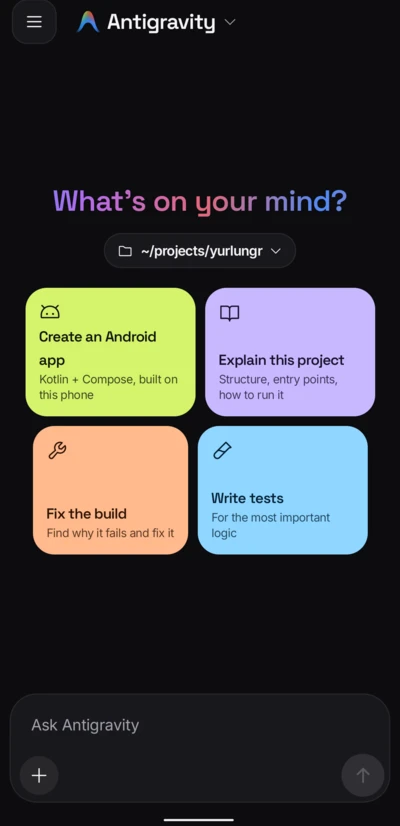
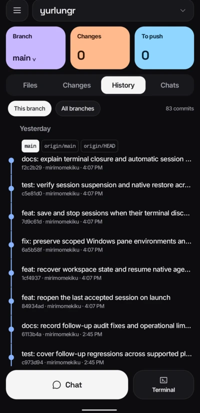
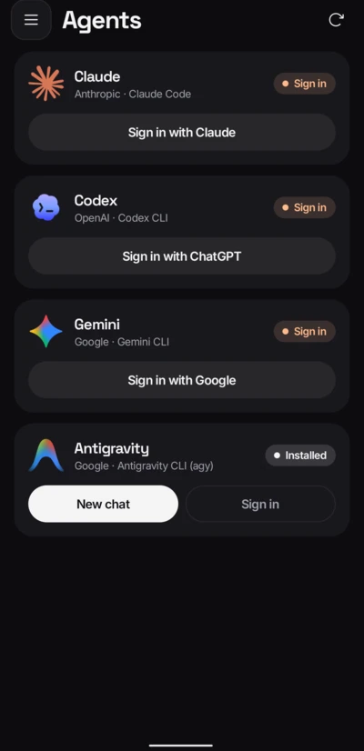
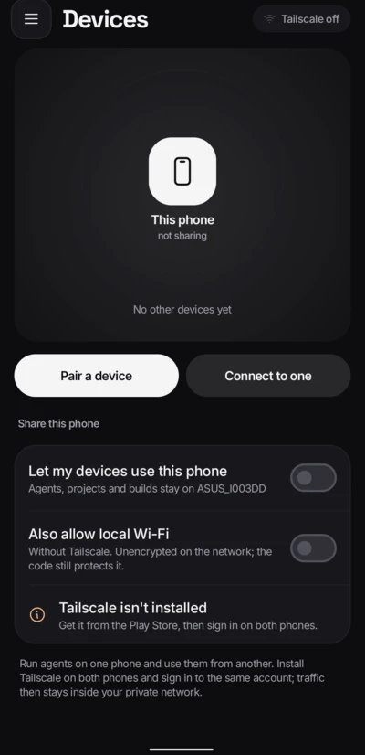
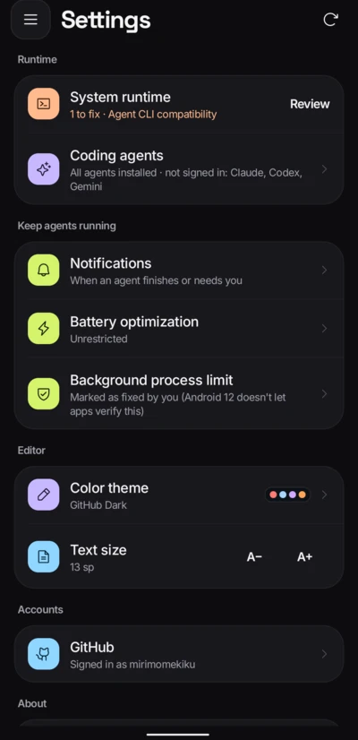

<h1 align="center">Yurlungr: AI coding agents on Android</h1>

  <b>Coding agents in your pocket.</b> 
  Run Claude Code, Codex, Gemini CLI, Antigravity and 18 more AI coding agents natively on your Android
  phone, in a built-in Linux runtime. Chat, edit, build, git and ship from one app. One APK, no Termux install.

  
  
  
  

  
  
  
  
  

Yurlungr is an Android app that turns your phone into a development machine for AI coding agents. Each
agent runs as its own command-line tool on the phone, inside an embedded Linux environment, and the app
talks to it over the [Agent Client Protocol (ACP)](https://agentclientprotocol.com). You get a full chat UI
with diffs and permission prompts, a terminal, a code editor, git, and on-device Android builds, with no
laptop, no remote server and no separate Termux app.

## Download

Get the APK for your phone's CPU from the [latest release](https://github.com/mirimomekiku/yurlungr/releases/latest)
and install it (allow installs from your browser or file manager when asked):

| APK | For |
|---|---|
| `yurlungr-<version>-arm64-v8a.apk` | Almost every phone from the last several years (recommended) |
| `yurlungr-<version>-armeabi-v7a.apk` | Older 32-bit phones |
| `yurlungr-<version>-x86_64.apk` / `-x86.apk` | Emulators and x86 devices |
| `yurlungr-<version>-universal.apk` | Any of the above, if you're unsure (slightly larger) |

Not sure? `adb shell getprop ro.product.cpu.abi` prints your phone's ABI. Each release lists SHA-256
checksums in `SHA256SUMS.txt`.

**Requirements:** Android 7.0 or newer (arm64 is the tested target) and about 4 GB of free space.

## Features

- **Real coding agents, really on-device.** Each chat starts the agent's own CLI and streams replies,
  thoughts, plans and tool calls with diffs. Approve or deny permission prompts, use slash commands, pick
  the model, effort and mode, and attach images and files.
- **An embedded Linux environment.** Node.js, git, Python, OpenJDK, Gradle and the Android SDK run inside
  the app, natively on arm64, with no proot and no separate Termux app. **Install tools** sets up git, the
  GitHub CLI, Node.js, Python, the agents and 40+ optional packs in one run.
- **Build Android apps on the phone.** Agents (or you) run `./gradlew assembleDebug`, and
  `yurlungr-install` opens the system installer for the APK you just built.
- **Projects and git.** A workspace per project with a file tree, a code editor, changes with diffs,
  single-hunk staging, commit, pull and push, branches, stashes and a coloured commit graph. Clone your
  GitHub repositories in a tap. Cloned code stays untrusted until you trust it.
- **A real terminal.** Terminal sessions with a floating session rail and extra keys.
- **Two phones, one workspace.** Share one phone's agents with another over Tailscale using a pairing
  code; traffic is encrypted end to end.
- **Keeps working with the screen off.** A foreground service keeps agents running, and a heads-up
  notification tells you when an agent needs your answer.
- **Checkpoints and approval rules.** The project is snapshotted before and after every prompt so you can
  restore an earlier state, and you can auto-approve the kinds of tool calls you trust.

## Supported coding agents

Claude Code, Codex, Gemini CLI and Antigravity are installed by default. The others are optional and
install one by one from **Agents → More agents**:

Qwen Code · Kimi Code · Auggie · Command Code · GitHub Copilot CLI · Goose · OpenCode · MiniMax Code · Pi ·
Qoder · Cline · Kilo Code · Cursor · Amp · Mistral Vibe · Kiro · fast-agent · Minion Code

You sign in to each agent with your own account or API key. The models still answer from their providers'
cloud; Yurlungr runs the agents' tools, files and builds on your phone.

## Getting started

1. **Set up the Linux environment.** The first-run System checks screen offers *Install*. Fix anything
   amber: battery optimisation, notifications, and on Android 12+ the background process limit.
2. **Install the tools and agents.** System checks → **Install tools** installs git, Node.js, Python, the
   coding agents and any optional packs in one go.
3. **Sign in.** Each agent's card has *Sign in*, which opens its own login.
4. **Chat.** Pick an agent and a project folder on the start screen and type.
5. **Build Android apps** (optional): Settings → System runtime → *Set up* the Android SDK.

## FAQ

**Can I run Claude Code on Android?**
Yes. Yurlungr installs Claude Code inside its embedded Linux runtime and runs it natively on arm64. The
same goes for Codex, Gemini CLI, Antigravity and the other agents listed above.

**Do I need Termux, a laptop or a remote server?**
No. The Linux environment is built into the app, and the agents, tools and builds run on the phone. You
only need an internet connection for the models themselves.

**Is it on the Play Store?**
No. Yurlungr is distributed as APKs on this repository's [releases page](https://github.com/mirimomekiku/yurlungr/releases).

**Why is the source not here?**
This repository is for releases only.

## License

Yurlungr is made available under the [PolyForm Noncommercial License 1.0.0](LICENSE).

Required Notice: Copyright (c) 2026 dlord213

For permissions outside those terms, contact the licensor through
[GitHub](https://github.com/mirimomekiku) to arrange a separate license.

Yurlungr is an independent project, not affiliated with Anthropic, OpenAI, Google or other agent makers.
Names and logos belong to their owners.
